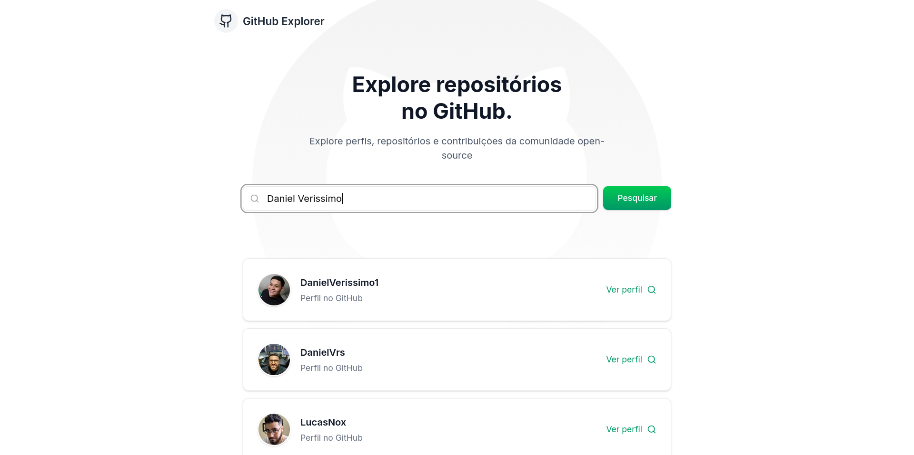

<h1 align="center">
  
  <br/>
  <p>GitHub Explorer</p>
  <p>
    
    
    
  </p>
</h1>

**GitHub Explorer** é uma aplicação web desenvolvida com **Next.js 15** e **TypeScript**, que permite buscar perfis do GitHub, visualizar informações do usuário e explorar seus repositórios públicos de forma simples e intuitiva.

---

## 📸 Visualização do Projeto

<p align="center">
  
</p>

---

## 🚀 Funcionalidades

| Funcionalidade | Descrição |
|----------------|-----------|
| 🔍 **Busca de Usuários** | Pesquise perfis do GitHub pelo nome de usuário |
| 👤 **Perfil do Usuário** | Visualize avatar, bio, repositórios, seguidores e seguindo |
| 📦 **Listagem de Repositórios** | Veja os repositórios públicos com estrelas, forks e issues |
| ⚡ **Rota Dinâmica** | Página dedicada por usuário via `/user/[username]` |
| 🔄 **Loading & Erros** | Feedback visual de carregamento e tratamento de erros |
| 🔍 **SEO Otimizado** | Metadados e Open Graph configurados no `layout.tsx` |

---

## 🛠️ Tecnologias Utilizadas

<div align="center">
  
  
  
  
  
  
  
  
  
</div>

---

## 📚 Conceitos Aplicados

- Next.js 15 com App Router
- TypeScript com tipagem estrita
- Consumo da API REST do GitHub com Axios
- Roteamento dinâmico com `[username]` para perfis de usuário
- Componentização e separação de responsabilidades
- Tailwind CSS com design responsivo
- Otimização de imagens com `next/image`
- SEO com metadados e Open Graph no `layout.tsx`
- Tratamento de erros com feedback visual

---

## ▶️ Como Rodar o Projeto

Após clonar o repositório, siga os passos abaixo:

```bash
# Instalar as dependências
npm install

# Iniciar o servidor de desenvolvimento
npm run dev

# Gerar o build de produção
npm run build

# Iniciar em modo produção
npm start
```

Acesse [http://localhost:3000](http://localhost:3000) no navegador.

---

## 📁 Arquitetura do Projeto

```
explorerepositorios/
│
├── public/
│   ├── Github.png             # Imagem de fundo
│   ├── Github.svg
│   └── thambnail.png          # Preview do projeto
│
├── src/
│   ├── app/
│   │   ├── user/
│   │   │   └── [username]/    # Página dinâmica de perfil do usuário
│   │   │       ├── layout.tsx
│   │   │       └── page.tsx
│   │   ├── globals.css
│   │   ├── layout.tsx         # Layout raiz com metadados SEO
│   │   ├── loading.tsx        # Tela de carregamento global
│   │   ├── notFound.tsx       # Página 404
│   │   └── page.tsx           # Página principal com busca
│   │
│   ├── components/
│   │   ├── github/
│   │   │   ├── EmptyState.tsx     # Estado vazio da busca
│   │   │   ├── RepoCard.tsx       # Card de repositório
│   │   │   ├── SearchSection.tsx  # Seção de busca
│   │   │   ├── UserCard.tsx       # Card de usuário nos resultados
│   │   │   └── UserProfile.tsx    # Perfil completo do usuário
│   │   ├── shared/
│   │   │   ├── ErrorDisplay.tsx   # Exibição de erros
│   │   │   ├── Header.tsx         # Cabeçalho da aplicação
│   │   │   └── LoadingSpinner.tsx # Spinner de carregamento
│   │   ├── ui/
│   │   │   ├── avatar.tsx
│   │   │   ├── button.tsx
│   │   │   ├── card.tsx
│   │   │   └── input.tsx
│   │   └── Footer.tsx
│   │
│   └── lib/
│       ├── githubApi.ts       # Instância Axios configurada para a API do GitHub
│       ├── types.ts           # Tipagens TypeScript (GitHubUser, GitHubRepo, etc.)
│       └── utils.ts
│
├── next.config.ts
├── tsconfig.json
├── package.json
└── README.md
```

<p align="center">Feito com 💚 por <strong>Daniel Verissimo</strong></p>
